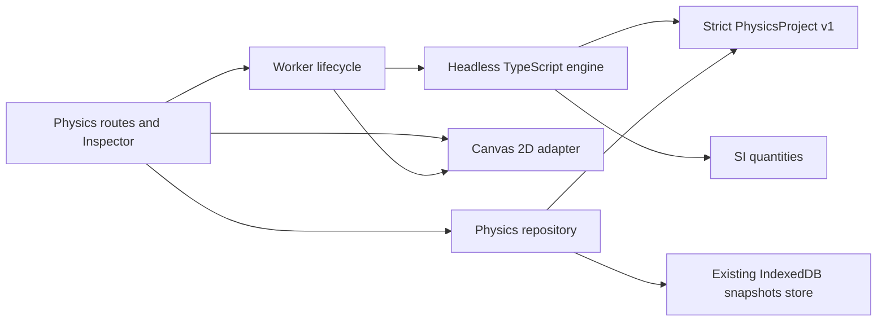

# Paramyra Physics — P0/P1 architecture decisions

Baseline: `origin/dev/master` at `845313c`, verified October 11, 2026.
Re-fetched October 13, 2026: the base is unchanged.
Epic: [#34](https://github.com/GendByteMaster/Paramyra/issues/34).
PRs #30–#33 are merged into that baseline. There were no open PRs at discovery.
Their IndexedDB editor cutover remains opt-in for Mathematics users; merged code
does not imply every browser has migrated. This document describes the delivered
P0/P1 slice, not completion of the whole epic.

## ADR 001 — independent platform ownership

Physics is a peer destination of Mathematics. Existing mathematical routes,
`MathDocument v3`, `NodeGraph v3`, authored mathematical keyframes, Coursework,
project registries and opt-in flags keep their contracts. `/physics` has its own
navigation; `/physics/experiments`, `/physics/playground`, `/physics/studio` and
`/physics/projects` share one domain and viewport adapter.

Dependency direction is routes and UI → application runtime/repository → domain.
`core/physics/model`, `units`, `engine` and `experiments` are framework-independent.
The worker adapter uses browser APIs; Canvas is presentation; React coordinates
interaction. Neither the engine nor project schema imports Mathematics documents,
React, React Flow, Next.js, rendering or browser storage.



The initial project is one validated experiment with one physical body. It is
not a generic multi-body editor. Graph authoring, visual keyframes, constraints,
custom equation authoring and full labs are later contracts, not empty runnable
features. Fixed built-in equations avoid a second expression interpreter.

## ADR 002 — one storage authority

Physics uses the proven M4.2 transaction pattern and existing `openDatabase`
adapter. The `physics-library-live` record lives in the existing
`paramyra-studio-checkpoints` database, version 1, `snapshots` store, alongside
but independently of Mathematics records. No database version upgrade, implicit
Math migration, legacy key deletion or Physics localStorage project mirror occurs.

A complete Physics library has at most 20 projects, one active ID or an empty
library, and one monotonic safe-integer revision. Readwrite transactions validate
the stored record, compare expected revision **and** expected active ID, run a
synchronous pure mutation, validate the entire proposed library, then commit.
Success is reported only when the transaction completes. A stale tab receives a
conflict; abort/quota/unavailable storage leaves the durable record unchanged.

The editor hydrates before presenting a saved project. Authored drafts live in
memory until explicit Save; they are not another durable authority. Playground
is transient until explicit Save to Studio creates a separately owned project.
Worker frames, selection, playhead and live samples are disposable. Project edits,
camera/grid settings and report draft belong to the authored project.

Unknown/future versions, corrupt JSON and invalid structured clones fail closed.
There is no historical Physics format to migrate: v1 is the first version, with
explicit version validation. Existing Mathematics v1/v2 migrations continue in
their original modules. A future Physics migration must validate both input and
output and execute through the same CAS transaction; it must not reset corrupt
records to an empty library. Import assigns a fresh project identity only after
complete validation and preserves existing projects. Project JSON is capped at
256 KiB; the complete library is capped at 1,000,000 bytes.

Risk Gate: **High** for new durability/recovery semantics. Blast radius is the
new Physics record; Mathematics records are never mutated by Physics. Only code
and test-browser data are changed. Recovery consists of exporting a valid draft
before reload, retaining corrupt records for diagnosis, and reverting these
isolated modules. Reverting removes access to Physics UI without deleting stored
Physics records. Browser eviction or cleared storage can still lose local data;
JSON exports are the portable backup. No production migration is executed.

## ADR 003 — numerical core and canonical SI

`PhysicsProject v1` strictly owns identity/timestamps, `unitPolicy: SI`, a
versioned discriminated model, simulation settings, 2D scene/camera and report.
All nested objects reject unknown fields. Parameters are canonical finite SI
numbers with physical and stability constraints. Unit values use the seven SI
base exponents; operations compare dimensions rather than display labels.
Addition/subtraction require equal dimensions; products/division combine
exponents; powers and transcendental functions enforce their dimensional domain.

Supported models:

| Model | Equations | Interpretation |
| --- | --- | --- |
| Projectile v1 | `x'=vx; y'=vy; vx'=-b vx/m; vy'=-g-b vy/m` | Constant downward gravity, optional linear drag `b` in kg/s; point mass; stop at the ground, no bounce |
| Mass–spring v1 | `x'=v; v'=(-k x-c v)/m` | Horizontal displacement from equilibrium, Hooke stiffness N/m, viscous damping kg/s; no forcing or contact |

The model assumptions follow the standard introductory references for
[projectiles](https://openstax.org/books/university-physics-volume-1/pages/4-3-projectile-motion),
[harmonic motion](https://openstax.org/books/university-physics-volume-1/pages/15-1-simple-harmonic-motion)
and [damping](https://openstax.org/books/university-physics-volume-1/pages/15-5-damped-oscillations).
Linear drag extends the no-drag projectile reference using the stated ODE;
it is an idealization, not a full aerodynamic model.

Both models use fixed-step semi-implicit Euler: evaluate acceleration at the
current state, update velocity, then update position. Simulation time is derived
from an integer step index; ground contact is a documented within-step event.
Contact uses the partial symplectic map `y(τ)=y₀+(vᵧ₀+aᵧτ)τ`, with the earliest
positive root inside the crossed interval; position and velocity use that same
partial step. This is first-order event localization, not exact continuous
ballistic impact. Coarse time steps can substantially shift impact time.
Reset and replay restore the original model, parameters and integrator version.
The engine terminates at duration/contact and rejects non-finite results and
unbounded stepping requests. Stability limits are necessary admission checks,
not a promise of accurate results at every admitted step size.

Analytical references are independent of the stepping implementation. No-drag
projectiles compare `x=x0+vx0 t`, `y=y0+vy0 t-g t²/2`; linear drag uses an exponential
reference. Undamped springs compare `x=x0 cos(ωt)+(v0/ω)sin(ωt)`, `ω=sqrt(k/m)`;
damped fixtures use the appropriate exact linear ODE solution. Tests check
step refinement, signs, parameter rejection, bounded energy error, event behavior
and reproducible replay. See the unit tests for actual dimensional tolerances.
Symplectic Euler is first order and does not conserve exact physical energy.
Same-input replay is deterministic in the same execution environment;
cross-browser floating-point bitwise identity is not guaranteed.

## ADR 004 — execution and lifecycle

The versioned worker protocol carries session and monotonic request IDs.
Requests initialize/run/pause/step/reset/seek/dispose; responses contain bounded
frames, measurements, state and diagnostics. New project or parameter setup
creates a new worker session; older responses cannot overwrite the new setup.
Pause/reset/dispose cancel scheduled work. Worker errors retain the authored
project and expose restart/recovery controls. Worker support is required for
simulation; there is no silent main-thread solver fallback.

Logical time remains independent of wall-clock rendering. Catch-up is limited
by maximum substeps and a CPU budget; a runtime that cannot keep up pauses with
an explanation. Seeking replays from initial conditions in cancellable chunks,
rather than directly substituting time into a displayed animation. Live history
is bounded to 2,048 samples and is not stored automatically. Measurement export
contains SI units, model/version, parameters, fixed step and solver provenance.
Rendering never modifies authoritative numerical state.

## P0 extension contract — intentional interop

P1 has no implicit Math↔Physics link. Its measurement JSON is a versioned
`paramyra.physics.measurements` snapshot with validated frame records and solver
provenance. Validation checks clock/termination and model-derived quantities;
it does not certify that imported samples came from an engine run. A later P3
adapter must treat external snapshots as untrusted data. It may consume the export, show a conversion
preview and require confirmation before creating a Mathematics artifact. It must
map quantities/units and record source project/model/version and any lossiness.
Neither domain may read the other's mutable editor snapshot as its engine state.
The existing Mathematics AST remains the candidate safe expression parser for
future explicitly typed equation imports; no arbitrary code execution is added.

## UI composition and delivery boundary

```text
Physics / Mathematics navigation · Gallery · Playground · Studio · Projects
┌───────────────────┬──────────────────────────┬─────────────────────┐
│ Experiment/project│ SI Canvas: grid, trajectory│ Parameter Inspector │
│ selection         │ spring/body, force/velocity│ equations/assumptions│
│ local project tools│ Fit · Pan · Zoom · Reset  │ report draft        │
├───────────────────┴──────────────────────────┴─────────────────────┤
│ Run · Pause · Step · Reset · simulation time and replay controls     │
│ Measurements: numerical readouts, accessible table, CSV/JSON export │
└────────────────────────────────────────────────────────────────────┘
```

This adapts [Apple HIG](https://developer.apple.com/design/human-interface-guidelines)
principles to the existing Paramyra design: content hierarchy, readable labels,
keyboard focus, touch-size targets, quiet materials, explicit status, light/dark
appearance and reduced motion. Small viewports use contained responsive panels
and document scrolling so controls remain reachable. No autoplay is required.

Next: P2 authoring/undo, pendulum/incline, guided labs and richer plots/printing;
then P3 an independently typed unit-aware Physics Graph with React Flow as its
view, using this same repository commit boundary. 3D, orbital models, sweeps,
cloud services and other physics disciplines are not in this PR.
